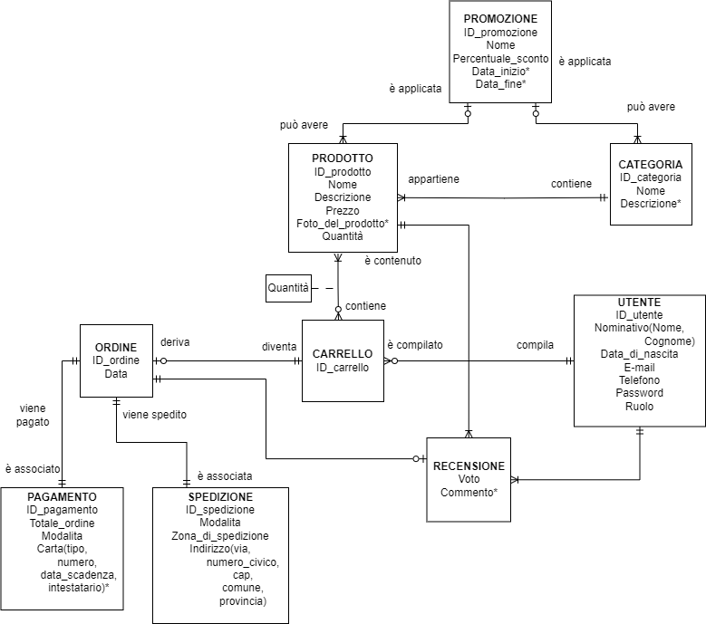
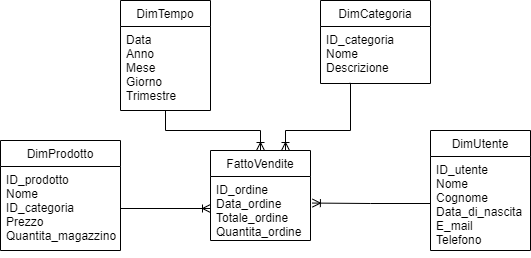

# E-commerce Database Design: Relational, Data Warehouse & NoSQL

End-to-end design and implementation of the data layer for an e-commerce platform: from requirements analysis and ER modelling to a **MySQL** relational database, a **star-schema data warehouse** with OLAP analytics in Python, and a **MongoDB** extension for semi-structured data such as product reviews.

Academic group project for the **Databases** course of the B.Sc. in Statistics for Big Data (University of Salerno, A.Y. 2023/2024).

📄 **[Read the full project report (PDF, Italian)](docs/report_IT.pdf)**: requirements, conceptual/logical/physical design, constraints, queries and analytics.

<p align="center">
  
</p>

## Overview

The system supports the daily operations of an online store: product catalogue and categories, user accounts with roles, shopping carts, orders with shipping and payment details, inventory tracking, time-limited promotions on products or categories, and customer reviews.

The project follows the **Systems Development Life Cycle (SDLC)**:

1. **Planning & analysis**: business rules, glossary and use cases for customers and administrators.
2. **Conceptual design**: Entity-Relationship model with domain and integrity constraints.
3. **Logical & physical design**: translation into a normalized relational schema implemented in MySQL.
4. **Implementation**: schema creation, a populated sample database and 23 SQL queries covering every functional requirement.
5. **Analytics**: a star-schema data warehouse and an interactive Python OLAP report.
6. **NoSQL extension**: a MongoDB model for flexible, semi-structured customer data.

## Repository structure

```
├── README.md
├── requirements.txt
├── sql/
│   ├── 01_create_schema.sql          → relational schema (9 tables, PK/FK constraints)
│   ├── 02_populate_db.sql            → sample data (~300 rows: 52 products, 34 users, 42 orders, ...)
│   └── 03_functional_queries.sql     → 23 queries: catalogue, cart, orders, promotions, reviews, reports
├── data_warehouse/
│   ├── 01_create_and_populate_dw.sql → star schema (FattoVendite + Time, Product, Category, User dimensions)
│   ├── 02_olap_queries.sql           → analytical queries (sales by category, product, year/month)
│   └── olap_report.py                → interactive CLI report with tables and charts
├── nosql/
│   ├── 01_populate.js                → MongoDB collections (products, users, reviews)
│   └── 02_queries.js                 → find and aggregation pipelines ($lookup, $match, $project)
├── diagrams/
│   ├── conceptual_schema.png         → conceptual schema
│   ├── er_model.png                  → ER model
│   ├── logical_schema_mysql.png      → MySQL Workbench logical model
│   ├── star_schema.png               → data warehouse star schema
│   ├── logical_schema.mwb            → MySQL Workbench source
│   └── drawio/                       → editable draw.io sources
└── docs/
    └── report_IT.pdf                 → full project report (Italian)
```

## Relational database (MySQL)

Main entities: **Categoria, Prodotto, Utente, Ruolo, Promozione, Carrello, Linea_di_carrello, Ordine, Recensione**.

Business rules enforced by the schema include:
- each product belongs to exactly one category;
- a cart can hold one or more products (via `Linea_di_carrello`), and a confirmed cart generates one order with shipping and payment details;
- a promotion applies to a specific product **or** category, has a limited duration, and each product or category can have only one active promotion;
- reviews are linked to a customer and a product and include a rating and a comment.

The 23 queries in `03_functional_queries.sql` cover catalogue management (insert/update/delete), cart and order handling, promotions, reviews, user management and reporting (best-selling products, most loyal customers, purchase history by year, sales by shipping zone).

## Data warehouse & OLAP

<p align="center">
  
</p>

A star schema with the fact table **FattoVendite** (sales) and the dimensions **DimTempo, DimProdotto, DimCategoria, DimUtente** supports sales analysis. `olap_report.py` connects to the warehouse and offers an interactive menu with:
- total sales by category (pie chart or table);
- quantity sold per product;
- total sales by year and month.

## NoSQL extension (MongoDB)

To handle semi-structured data more flexibly, such as customer feedback and interactions, products, users and reviews are also modelled as MongoDB collections. The queries include range filters and aggregation pipelines that join users and reviews with `$lookup`, for example to find customers who left reviews rated above 3.

## How to run

**Relational database** (MySQL 8):
```bash
mysql -u root -p < sql/01_create_schema.sql
mysql -u root -p progetto_fav < sql/02_populate_db.sql
mysql -u root -p progetto_fav < sql/03_functional_queries.sql
```

**Data warehouse and OLAP report:**
```bash
mysql -u root -p < data_warehouse/01_create_and_populate_dw.sql
pip install -r requirements.txt
export DB_PASSWORD=your_password   # optional: DB_HOST, DB_USER, DB_NAME
python data_warehouse/olap_report.py
```

**MongoDB** (mongosh):
```bash
mongosh ecommerce nosql/01_populate.js
mongosh ecommerce nosql/02_queries.js
```

## Tech stack

MySQL · MySQL Workbench · SQL · Python (mysql-connector, Matplotlib, PrettyTable) · MongoDB · draw.io

## Authors

Team FAV: Angelo Frattolillo, Francesca Longo, Valentina Santorelli.

*Note: table names, code comments and the report are in Italian, as in the original course submission. All sample data is fictitious.*
